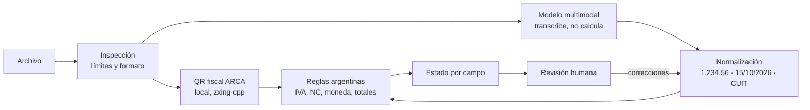

# ExpenseLens

**Convierte tickets y facturas argentinas en gastos verificables.** La IA lee el
comprobante, el código normaliza y valida, el QR fiscal de ARCA lo contrasta y
una persona confirma. Ningún dato se acepta solo porque lo dijo un modelo.

> La IA interpreta; el código calcula; la persona aprueba.

## El problema

Cargar gastos a mano es lento y propenso a errores: importes con `1.234,56`,
facturas A/B/C con y sin IVA discriminado, notas de crédito que restan, pagos en
dólares, subtotales confundidos con totales. Un OCR genérico lee texto; no sabe
cuándo **no** confiar en lo que leyó.

## Qué hace

1. **Carga** un JPEG, PNG o PDF (hasta 3 páginas) con vista previa.
2. **Lee el QR fiscal localmente**, antes de enviar nada afuera.
3. **Transcribe** con un modelo multimodal (Groq), solo con consentimiento explícito.
4. **Normaliza** formatos argentinos con código determinista.
5. **Valida** con reglas fiscales y aritméticas, y contrasta contra el QR.
6. **Muestra el estado de cada campo** para que la persona revise y corrija.
7. **Sugiere la categoría** (IA y reglas), medida contra lo que elige la persona.
8. **Guarda el gasto** solo cuando la persona confirma, frena duplicados y arma
   el historial con filtros, totales por moneda y exportación CSV.

| Estado del campo | Significado |
|---|---|
| Verificado por QR | Coincide con el QR fiscal: dos fuentes independientes de acuerdo. |
| Revisar | Una regla o el QR lo contradicen. |
| Faltante | El tipo de comprobante lo requiere y no se leyó. |
| Sin verificar | Lo leyó el modelo, sin segunda fuente. |

## Arquitectura



El mismo pipeline determinista procesa la salida del modelo y las correcciones
de la persona: `POST /receipts/validate` vuelve a normalizar, validar y contrastar
con el QR. El proveedor de IA es un Adapter reemplazable (`extraction.py`); la
lógica de negocio (`normalize.py`, `rules.py`, `fiscal_qr.py`) no lo conoce.

## Decisiones de AI engineering

- **El modelo transcribe, el código decide.** El prompt pide copiar `"1.234,56"`
  tal como aparece. Convertirlo es trabajo de código testeado, no de un LLM que
  puede confundir separadores o "corregir" una suma.
- **Confianza por contraste, no por autoevaluación.** No se le pregunta al
  modelo qué tan seguro está. Un campo es confiable cuando una fuente
  independiente (el QR fiscal) coincide; si no, queda "sin verificar".
- **Ante ambigüedad, `null`.** `1.234` puede ser mil doscientos treinta y cuatro
  o uno con decimales: se marca para revisión en lugar de adivinar.
- **El documento es dato no confiable.** Instrucciones escritas en la imagen se
  ignoran, y el QR también se valida estrictamente (host oficial, versión,
  dígito verificador del CUIT). Hay un caso de inyección en el dataset.
- **El QR devuelto al cliente lleva firma HMAC.** El servidor rechaza QR sin
  firma o alterados antes de marcarlos verificados; `EXPENSE_LENS_SECRET` debe
  ser estable para que sobrevivan reinicios.
- **Fallar visible y acotado.** Una llamada por solicitud, sin reintentos;
  un HTTP 429 se informa como tal. El modelo nunca es la única defensa.
- **Las correcciones humanas son datos.** Cada gasto guarda qué campos cambió
  la persona respecto de lo que leyó el modelo; `GET /expenses/stats` muestra la
  tasa de corrección por campo con uso real, no solo con el dataset.
- **Medir antes de afirmar.** Un dataset con verdad conocida mide exactitud
  por campo y, sobre todo, si el sistema detecta sus propios errores.

## Especialización argentina

- Importes `1.234,56`, `1,234.56`, `$`, `US$`, `U$S`; fechas día/mes/año.
- CUIT con dígito verificador módulo 11.
- Facturas A, B, C, E y M; notas de crédito y débito; tickets.
- Factura A exige IVA discriminado; B y C no; Factura C con IVA se advierte.
- Nota de crédito → movimiento que **resta**, no una compra.
- Dólares y euros se conservan en su moneda: **nunca** se convierten.
- QR fiscal ARCA (RG 4892/2020): CUIT, fecha, punto de venta, número, tipo,
  moneda y total contrastados contra lo visible.

Detalle de contratos, reglas y límites: [docs/technical.md](docs/technical.md).

## Evaluación

`eval/dataset/` tiene 12 comprobantes **ficticios** con verdad conocida,
generados por `eval/generate_dataset.py`: factura A con QR coincidente y con
QR que contradice el total, factura B con IVA incluido, factura C, ticket de
supermercado, nota de crédito, factura en USD, foto inclinada y borrosa, PDF
multipágina, importe ambiguo, imagen que no es un comprobante e intento de
inyección de instrucciones.

| Métrica | Pregunta que responde |
|---|---|
| Exactitud por campo | ¿Cuántos datos se leyeron bien? |
| Campos inventados | ¿El modelo completó algo que no figura? |
| Recall de detección | De los datos erróneos, ¿cuántos quedaron marcados para revisar? |
| Falsos verificados | ¿Algún dato erróneo quedó como "verificado"? Debe ser 0. |
| Tasa de revisión | ¿Cuánto trabajo le queda a la persona? |

### Resultados (`eval/results/eval-002`)

Corrida real con `qwen/qwen3.8-27b`: 12 llamadas, una por caso, sin reintentos.
Tres casos recibieron HTTP 429 del proveedor y se informan como fallos, no como aciertos.

| Métrica | Sobre 9 casos evaluados |
|---|---|
| Exactitud por campo | 96,7% (todos los campos 100% salvo `subtotal`, 66,7%) |
| Falsos verificados | **0** |
| Estado del QR fiscal correcto | 100% |
| Campos inventados | 3 |
| Latencia | mediana 1,2 s |

**Análisis de errores → regla → re-medición.** Los tres campos inventados fueron
el mismo patrón: en facturas B, C y E sin IVA discriminado, el modelo copió el
total en `subtotal`, aunque el prompt pide `null`. Ninguna regla lo detectaba
(recall de detección 0%). Se agregó `subtotal_equals_total` y se re-midió
**offline sobre las mismas transcripciones**, sin volver a llamar al modelo:

| | Antes | Con la regla |
|---|---|---|
| Recall de detección | 0% (0 de 3) | 100% (3 de 3) |
| Tasa de revisión | 33% | 67% |
| Falsos verificados | 0 | 0 |

La regla no mejora lo que lee el modelo: mejora cuándo el sistema sabe que no
debe confiar. El costo es más revisión humana, y queda medido.
Muestra chica y sintética: no es una estimación para comprobantes reales.

### Categoría sugerida: modelo contra línea base (`eval/results/eval-003`)

El modelo sugiere la categoría en la **misma llamada** de extracción, sin costo
extra; una línea base de palabras clave sobre el emisor compite con él. Ambos
usan el mismo criterio escrito por categoría (`CATEGORY_GUIDE`), compartido con
las etiquetas del dataset. La persona siempre decide.

| Sobre 10 casos evaluados (2 HTTP 429) | Modelo | Reglas por emisor |
|---|---|---|
| Exactitud de categoría | 10/10 | 3/10 |

Las reglas casi no se equivocan: **se abstienen** cuando el emisor no es
reconocible ("Cafetería Segura", "Servicios Imaginarios SRL"). El modelo aporta
cobertura porque lee el detalle ("Almuerzo ejecutivo", "Mantenimiento mensual").
El dataset es sintético y explícito: es un resultado fácil, no una garantía.
En uso real, cada gasto guarda si la persona aceptó la sugerencia y
`GET /expenses/stats` informa la tasa de aceptación por fuente.

En esta corrida los campos llegaron al 100% y el modelo no repitió la copia del
total en `subtotal`. Con 10 casos no se distingue el efecto del prompt nuevo de la
variación entre corridas, así que la regla `subtotal_equals_total` se mantiene.

```bash
uv run python eval/run.py eval/results/<nombre> --allow-provider --pause-seconds 20
uv run python eval/score.py eval/results/<nombre>                 # offline
uv run python eval/score.py eval/results/<nombre> --replay-rules  # reglas actuales
```

El runner hace una llamada por caso, sin reintentos, y nunca sobrescribe una
corrida. `eval-001` lanzó los casos sin pausa: 10 de 12 recibieron HTTP 429 y se
conservan así. La primera prueba con un único recibo está en
[eval/results/smoke-001](eval/results/smoke-001/README.md).

## Gestión de gastos

- **Confirmar gasto** con categoría: el servidor vuelve a normalizar y validar;
  nunca confía en estados enviados por el navegador.
- **Duplicados bloqueados hasta revisión** (409): mismo comprobante fiscal
  (CUIT, tipo, letra, punto de venta y número), mismo archivo (SHA-256) u
  operación similar (emisor, fecha y total). La persona ve cuál es el gasto
  existente y puede guardar de todos modos.
- **Historial** con filtros por fecha, comercio, categoría, importe y moneda.
  Totales por moneda sin mezclarlas; las notas de crédito restan.
- **CSV** listo para planilla, protegido contra inyección de fórmulas.
- **Privacidad:** SQLite local (`data/expenses.sqlite`, ignorado por Git). Se
  guardan los datos y el hash del archivo, **nunca la imagen**. Borrado definitivo.

## Stack

Python 3.12 · FastAPI · Pydantic · SQLite · Groq (`qwen/qwen3.8-27b`) · PDFium ·
zxing-cpp · React + TypeScript + Vite · Vitest · pytest · Ruff.

## Ejecutar localmente

Requisitos: Python 3.12 o superior y [uv](https://docs.astral.sh/uv/).
Desde esta carpeta:

```bash
uv sync --locked
EXPENSE_LENS_SECRET='secreto-aleatorio-largo-y-estable' uv run --env-file .env uvicorn expense_lens.main:app --reload --host 127.0.0.1
```

- Salud: <http://127.0.0.1:8000/health>
- Documentación interactiva: <http://127.0.0.1:8000/docs>
- Contrato OpenAPI: <http://127.0.0.1:8000/openapi.json>

`GET /health` devuelve:

```json
{"status":"ok","service":"expense-lens"}
```

Es una comprobación de respuesta de la API, no de servicios externos.
Servidor local de desarrollo: no desplegar públicamente como está.

### Interfaz web

En otra terminal, desde esta carpeta:

```bash
cd web
npm ci
npm run dev
```

Abrí <http://127.0.0.1:5173> con la API ejecutándose en el puerto 8000.
Vite reenvía `/receipts` a la API local. Seleccioná un archivo, revisá la vista
previa y aceptá el procesamiento externo antes de extraer. Después podés corregir
los campos y usar **Validar correcciones**, que no llama a Groq.

El arranque anterior deja la extracción deshabilitada. Para habilitarla
explícitamente, reemplazá el comando del servidor por:

```bash
EXPENSE_LENS_SECRET='secreto-aleatorio-largo-y-estable' EXPENSE_LENS_ENABLE_GROQ=1 uv run --env-file .env uvicorn expense_lens.main:app --reload --host 127.0.0.1
```

Cada extracción autorizada puede consumir cuota del proveedor. El consentimiento
no se conserva al cambiar de archivo. Más detalles en [web/README.md](web/README.md).

### Proveedor seleccionado: Groq

Crear un `.env` local con `GROQ_API_KEY`. Está ignorado por Git y no debe
publicarse; no pegar su valor en documentación o logs. El comando de arranque
usa `uv --env-file` para cargarla en el proceso.

La clave sola no habilita extracción: se requiere `EXPENSE_LENS_ENABLE_GROQ=1`
en el entorno del servidor, además del consentimiento explícito por solicitud.

## Verificar

Ejecutar desde `expense-lens/`, no desde el directorio de estudio padre.

```bash
uv run pytest -q
uv run ruff check .
uv run ruff format --check .
(cd web && npm test && npm run build)
```

El primer test se ejecutó antes de crear el módulo de la API: falló por módulo
ausente (RED); con la implementación pasa (GREEN).
La combinación actual de Starlette y httpx emite una advertencia de deprecación
del cliente de pruebas; no afecta el resultado y no se oculta.

Para el editor, abrir esta carpeta y seleccionar `.venv/bin/python`.
`pyrightconfig.json` declara ese entorno y `src` como ruta de imports. El LSP
iniciado desde el workspace padre puede seguir sin reconocerlos; durante este
incremento reportó imports faltantes, aunque la suite en el entorno uv pasa.
No se considera un typecheck limpio ni se suprimen esos diagnósticos.

## Límites conocidos

- Desarrollo local de una sola persona: sin autenticación, separación entre
  usuarios ni sandbox de parsers. No desplegar públicamente como está.
- El QR válido no prueba autenticidad: no se consulta a ARCA.
- El dataset es sintético: mide comportamiento del pipeline, no generalización
  a comprobantes reales.
- Un archivo = un comprobante; no se detectan varios en el mismo documento.
- No es asesoramiento tributario ni realiza pagos.

## Próximos pasos

- **Paneles:** gastos mensuales, recurrentes y presupuestos.
- **Dataset ampliado:** comprobantes reales anonimizados con autorización.
- **Canal WhatsApp** como Adapter de entrada sobre el mismo pipeline.
- **Multiusuario:** autenticación y separación de datos antes de cualquier despliegue.
