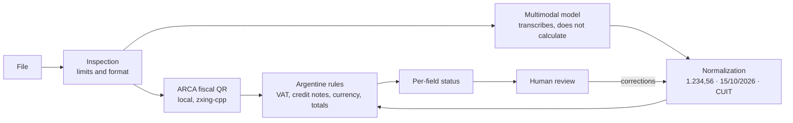

# ExpenseLens

**A local prototype for reviewing Argentine receipts and invoices.** AI can read
the document with consent, code normalizes and validates it, the fiscal QR adds
independent evidence, and a person confirms the result. No data is accepted just
because a model said so.

## Status and demo

ExpenseLens is complete as a local, single-user portfolio project. It is not
production-ready and must not be exposed publicly: it lacks authentication,
multitenant isolation, and a complete sandbox. The reproducible demo is in
[docs/demo.md](docs/demo.md). It uses synthetic files; extraction requires
consent and may call the external provider when enabled.

> AI interprets; code computes; a person approves.

## The problem

Entering expenses manually is slow and error-prone: amounts such as `1.234,56`,
A/B/C invoices with and without itemized VAT, credit notes that subtract, payments
in dollars, and subtotals confused with totals. Generic OCR reads text; it does
not know when **not** to trust what it read.

## What it does

1. **Upload** a JPEG, PNG, or PDF (up to 3 pages) with a preview.
2. **Read the fiscal QR locally**, before sending anything externally.
3. **Transcribe** with a multimodal model (Groq), only with explicit consent.
4. **Normalize** Argentine formats with deterministic code.
5. **Validate** with tax and arithmetic rules, and compare against the QR.
6. **Show each field’s status** so a person can review and correct it.
7. **Suggest a category** (AI and rules), measured against the person’s choice.
8. **Save the expense** only after confirmation, block duplicates, and provide
   filtered history, totals by currency, and CSV export.

| Field status | Meaning |
|---|---|
| “Verificado por QR” (“Verified by QR”) | Matches the fiscal QR: two independent sources agree. |
| “Revisar” (“Review”) | A rule or the QR contradicts it. |
| “Faltante” (“Missing”) | Required by the document type but not read. |
| “Sin verificar” (“Unverified”) | Read by the model, with no second source. |

## Architecture



The same deterministic pipeline processes model output and human corrections:
`POST /receipts/validate` normalizes, validates, and compares against the QR again.
The AI provider is a replaceable Adapter (`extraction.py`); the business logic
(`normalize.py`, `rules.py`, `fiscal_qr.py`) does not depend on it.

## AI engineering decisions

- **The model transcribes; code decides.** The prompt asks it to copy `"1.234,56"`
  exactly as shown. Conversion belongs in tested code, not an LLM that may
  confuse separators or “correct” a sum.
- **Confidence through comparison, not self-assessment.** The model is not
  asked how confident it is. A field is trusted when an independent source (the
  fiscal QR) agrees; otherwise it remains “unverified.”
- **Resolve ambiguity only with visible assumptions.** Interpret `1.234` using
  consistent decimal-format evidence from other amounts, then document-currency
  defaults if needed. Report the interpretation with an informational issue;
  unresolved values remain `null` and require review.
- **Treat the document as untrusted data.** Ignore instructions written in the
  image, and validate the QR strictly (official host, version, CUIT check digit).
  The dataset includes an injection case.
- **The QR returned to the client is HMAC-signed.** The server rejects unsigned
  or altered QR data before marking it verified; `EXPENSE_LENS_SECRET` must
  remain stable across restarts.
- **Fail visibly and within bounds.** One call per request, no retries; HTTP 429
  is reported as such. The model is never the only defense.
- **Human corrections are data.** Each expense records which fields the person
  changed from the model’s output; `GET /expenses/stats` reports real-use
  correction rates by field, not just dataset results.
- **Measure before making claims.** A dataset with known ground truth measures
  field accuracy and, above all, whether the system detects its own errors.

## Argentine-specific behavior

- Amounts `1.234,56`, `1,234.56`, `$`, `US$`, `U$S`; dates day/month/year.
- CUIT validated with the modulus-11 check digit.
- A, B, C, E, and M invoices; credit and debit notes; receipts.
- Invoice A requires itemized VAT; B and C do not; VAT on invoice C is flagged.
- Credit note → a movement that **subtracts**, not a purchase.
- Dollars and euros remain in their original currency: they are **never** converted.
- ARCA fiscal QR (RG 4892/2020): CUIT, date, point of sale, number, type,
  currency, and total are compared against visible values.

Contract, rule, and limit details: [docs/technical.md](docs/technical.md).

## Evaluation

`eval/dataset/` contains 12 **fictional** receipts with known ground truth,
generated by `eval/generate_dataset.py`: invoice A with a matching QR and one
whose QR contradicts the total, invoice B with VAT included, invoice C,
supermarket receipt, credit note, USD invoice, tilted and blurry photo,
multipage PDF, ambiguous amount, non-receipt image, and instruction-injection attempt.

| Metric | Question answered |
|---|---|
| Field accuracy | How many values were read correctly? |
| Invented fields | Did the model fill in anything not present? |
| Detection recall | How many incorrect values were flagged for review? |
| False verified fields | Was any incorrect value marked “verified”? Must be 0. |
| Review rate | How much work remains for the person? |

### Results (`eval/results/eval-002`)

Real run with `qwen/qwen3.8-27b`: 12 calls, one per case, no retries.
Three cases received provider HTTP 429 and are reported as failures, not successes.

| Metric | Across 9 evaluated cases |
|---|---|
| Field accuracy | 96.7% (all fields 100% except `subtotal`, 66.7%) |
| False verified fields | **0** |
| Fiscal QR status accuracy | 100% |
| Invented fields | 3 |
| Latency | median 1.2 s |

**Error analysis → rule → remeasurement.** The three invented fields followed
the same pattern: on invoices B, C, and E without itemized VAT, the model copied
the total into `subtotal`, although the prompt requests `null`. No rule detected
this (0% detection recall). `subtotal_equals_total` was added and measured again
**offline on the same transcripts**, without calling the model again:

| | Before | With the rule |
|---|---|---|
| Detection recall | 0% (0 of 3) | 100% (3 of 3) |
| Review rate | 33% | 67% |
| False verified fields | 0 | 0 |

The rule does not improve what the model reads; it improves the system’s ability
to recognize when not to trust it. The cost is more human review, and it is
measured. Small synthetic sample: not an estimate for real receipts.

### Historical category evaluation (`eval/results/eval-003`)

This is a historical run and **not a final evaluation of the current candidate
with signed QR and amount evidence**. Its results belong to the version evaluated
at that time; do not extrapolate them to the current version or real receipts.
The complete report preserves its metrics and limitations.

The model suggests a category in the **same extraction call**, at no extra cost;
a keyword baseline based on the issuer is compared against it. Both use the same
written category criteria (`CATEGORY_GUIDE`), shared with the dataset labels. The
person always decides.

| Across 10 evaluated cases (2 HTTP 429) | Model | Issuer rules |
|---|---|---|
| Category accuracy | 10/10 | 3/10 |

The rules rarely make mistakes: they **abstain** when the issuer is not
recognizable (“Cafetería Segura”, “Servicios Imaginarios SRL”). The model adds
coverage by reading line-item descriptions (“Almuerzo ejecutivo”, “Mantenimiento
mensual”). The dataset is synthetic and explicit: this is an easy result, not a
guarantee. In real use, each expense records whether the person accepted the
suggestion, and `GET /expenses/stats` reports acceptance rates by source.

In that run, field accuracy reached 100%, and the model did not repeat the
copying of the total into `subtotal`. With 10 cases, the effect of the new prompt
could not be distinguished from run-to-run variation, so the
`subtotal_equals_total` rule remains.

```bash
uv run python eval/run.py eval/results/<name> --allow-provider --pause-seconds 20
uv run python eval/score.py eval/results/<name>                 # offline
uv run python eval/score.py eval/results/<name> --replay-rules  # current rules
```

The runner makes one call per case, without retries, and never overwrites a run.
`eval-001` launched cases without pauses: 10 of 12 received HTTP 429, preserved
as-is. The first test with a single receipt is in
[eval/results/smoke-001](eval/results/smoke-001/README.md).

## Expense management

- **Confirm expense** with a category: the server normalizes and validates again;
  it never trusts statuses sent by the browser.
- **Duplicates blocked pending review** (409): same fiscal receipt (CUIT, type,
  letter, point of sale, and number), same file (SHA-256), or similar operation
  (issuer, date, and total). The person sees the existing expense and can save anyway.
- **History** with date, merchant, category, amount, and currency filters. Totals
  remain separate by currency; credit notes subtract.
- **CSV** ready for spreadsheets and protected against formula injection.
- **Privacy:** local SQLite (`data/expenses.sqlite`, Git-ignored). Data and the
  file hash are stored, **never the image**. Permanent deletion is supported.

## Stack

Python 3.12 · FastAPI · Pydantic · SQLite · Groq (`qwen/qwen3.8-27b`) · PDFium ·
zxing-cpp · React + TypeScript + Vite · Vitest · pytest · Ruff.

## Run locally

Requirements: Python 3.12 or later and [uv](https://docs.astral.sh/uv/).
From this directory:

```bash
uv sync --locked
# Once: generate a private secret for signing fiscal QR data and store it in .env.
echo "EXPENSE_LENS_SECRET=$(uv run python -c 'import secrets; print(secrets.token_hex(32))')" >> .env
uv run --env-file .env uvicorn expense_lens.main:app --reload --host 127.0.0.1
```

`.env` is Git-ignored: never publish this secret. If it is missing, the server
uses a random per-process value, and receipts must be extracted again after a restart.

- Health: <http://127.0.0.1:8000/health>
- Interactive documentation: <http://127.0.0.1:8000/docs>
- OpenAPI contract: <http://127.0.0.1:8000/openapi.json>

`GET /health` returns:

```json
{"status":"ok","service":"expense-lens"}
```

This checks the API response, not external services. This is a local development
server; do not deploy it publicly as-is.

### Web interface

In another terminal, from this directory:

```bash
cd web
npm ci
npm run dev
```

Open <http://127.0.0.1:5173> while the API is running on port 8000. Vite forwards
`/receipts` to the local API. Select a file, review its preview, and approve
external processing before extraction. You can then correct fields and choose
**“Validar correcciones” (“Validate corrections”)**, which does not call Groq.

The command above leaves extraction disabled. To explicitly enable it, replace
the server command with:

```bash
EXPENSE_LENS_ENABLE_GROQ=1 uv run --env-file .env uvicorn expense_lens.main:app --reload --host 127.0.0.1
```

Each authorized extraction may consume provider quota. Consent is not retained
when changing files. More details in [web/README.md](web/README.md).

### Selected provider: Groq

Create a local `.env` file with `GROQ_API_KEY`. It is Git-ignored and must not
be published; do not paste its value into documentation or logs. The startup
command uses `uv --env-file` to load it into the process.

The key alone does not enable extraction: the server environment must also set
`EXPENSE_LENS_ENABLE_GROQ=1`, and each request requires explicit consent.

## Verify

Run from `expense-lens/`, not from the parent study directory.

```bash
uv run pytest -q
uv run ruff check .
uv run ruff format --check .
(cd web && npm test && npm run build)
```

The first test ran before the API module was created and failed because the
module was missing (RED); it passes with the implementation (GREEN). The current
Starlette and httpx combination emits a deprecation warning for the test client;
it does not affect the result and is not suppressed.

For the editor, open this directory and select `.venv/bin/python`.
`pyrightconfig.json` declares that environment and `src` as the import path. The
LSP started from the parent workspace may still fail to recognize them; during
this increment it reported missing imports, although the suite passes in the uv
environment. This is not considered a clean typecheck, and those diagnostics are
not suppressed.

## Known limitations

- Local, single-user development: no authentication, user isolation, or parser
  sandbox. Do not deploy publicly as-is.
- A valid QR does not prove authenticity: ARCA is not queried.
- The synthetic dataset measures pipeline behavior, not generalization to real receipts.
- One file = one receipt; multiple receipts in a document are not detected.
- This is not tax advice and does not make payments.

## Next steps

- **Dashboards:** monthly and recurring expenses, and budgets.
- **Expanded dataset:** anonymized real receipts with authorization.
- **WhatsApp channel** as an input Adapter on the same pipeline.
- **Multi-user support:** authentication and data isolation before any deployment.
